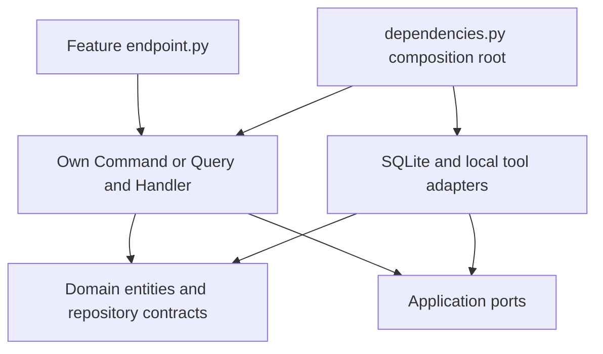

# AgentGate

AgentGate is a local, simulation-only reference project for controlling agent
actions. It makes deterministic authorization, independent approval, bounded
execution, idempotency and transactional audit observable in a small financial
simulation, with a real local MCP server and optional server-side conversational
AI. The manual lab needs no paid service; provider-backed chat requires a key.

**No real money moves.** Only `get_balance` and `simulate_transfer` operate on
local seeded USD accounts. This is educational reference code, not a production
banking service or a comprehensive security certification.

## Two harnesses

The **Development Harness** uses OpenSpec scenarios, [AGENTS.md](AGENTS.md),
Pytest (including architecture tests), Ruff, strict Mypy and GitHub Actions to
make changes reviewable. Follow propose → review → apply → verify; archive only
when separately requested.

The **Runtime Agent Harness** rechecks identity, policy, funds and approval at
execution, dispatches one registered local tool, and commits simulated effects
with their result and audit. Submission and approval never dispatch tools.
Executing even a balance lookup is a command because it records lifecycle evidence.

## Architecture

One modular monolith combines DDD (entities, immutable values and pure policies),
CQRS (commands and read-only queries over one database), Vertical Slice (each use
case owns its HTTP adapter and core), and Hexagonal Architecture (constructor-
injected contracts isolate concrete adapters). There is no mediator or event bus.



```mermaid
sequenceDiagram
    participant Agent
    participant API
    participant Human as Approver credential holder
    participant Harness
    participant DB as Local SQLite
    Agent->>API: Submit operation and idempotency key
    API->>DB: Atomic decision, pending approval and audit
    API-->>Agent: REQUIRE_APPROVAL
    Human->>API: APPROVE exact operation
    API->>DB: Atomic grant and audit
    Agent->>API: Execute operation ID, empty body
    API->>Harness: ExecuteOperationCommand
    Harness->>DB: Record attempt; revalidate under write transaction
    Harness->>DB: Atomic balances, result, consumption and success audit
    Harness-->>Agent: SUCCEEDED, effective ALLOW / HUMAN_APPROVED
    Agent->>API: Execute same ID again
    API-->>Agent: Stored result
```

Details: [architecture](docs/architecture.md), [runtime harness](docs/execution_harness.md),
[persistence and recovery](docs/persistence.md), [approval lifecycle](docs/human_approval_walkthrough.md),
[threat model](docs/threat_model.md), [scenario traceability](docs/requirements_traceability.md).

## Install and verify

Run from the repository root. Install Python 3.12 and uv 0.12.5 or newer.
Python 3.12.14 is currently selected in CI. The package declares Python >=3.12,
but later interpreters are not verified by that workflow. [uv.lock](uv.lock)
pins direct and transitive dependencies; [pyproject.toml](pyproject.toml)
defines supported ranges and tool configuration. Installation can download
packages; runtime needs no outbound services. Tests block outbound sockets and
subprocesses and use temporary SQLite databases and injected time.

For OpenSpec checks install Node.js (CI uses 22.16.0) and the pinned CLI:

```powershell
npm install --global --ignore-scripts --no-audit --no-fund @fission-ai/openspec@1.14.3
uv sync --locked --python 3.12
uv run --locked pytest
uv run --locked ruff check .
uv run --locked ruff format --check .
uv run --locked mypy --strict src
openspec validate --all --strict
```

After activating `.venv`, the Python gates are equivalently `python -m pytest`,
`python -m ruff check .`, `python -m ruff format --check .` and
`python -m mypy --strict src`. The [CI workflow](.github/workflows/ci.yml)
runs equivalent gates on pull requests and pushes to `main`, with read-only
repository permissions, pinned action revisions and a ten-minute job timeout.
A failed step fails its job. Branch protection and required GitHub checks are
configured outside this repository.

## Local setup

For the persistent PostgreSQL 16 browser lab, run
`powershell -NoProfile -ExecutionPolicy Bypass -File .\scripts\start_lab.ps1`.
Open <http://127.0.0.1:8080> and local Swagger at
<http://127.0.0.1:8001/docs>. See the [interactive lab guide](docs/interactive_lab.md)
and MCP Streamable HTTP at <http://127.0.0.1:8002/mcp>. Run
`uv run --locked python scripts/mcp_client.py list` to discover
`request_operation`, `get_operation` and `execute_operation`. The client uses
the independently generated local MCP credential; server-side AGENT credentials
stay in the MCP container. Human approval remains a separate frontend/API action.
This static local identity model is not production multi-user OAuth. See the
[Milestone B evidence](docs/milestone_b_verification.md) and lab guide for client
examples, transport security and durable replay. Milestone C adds optional AI chat;
see [configuration and usage](docs/interactive_lab.md#ai-chat-provider-configuration)
and [C verification evidence](docs/milestone_c_verification.md).
The original SQLite setup below remains available.

Use PowerShell from the repository root. Generate two independent ephemeral
tokens into the current environment; no default credential is provided or printed:

```powershell
$env:AGENTGATE_AGENT_TOKEN = uv run --locked python -c "import secrets; print(secrets.token_urlsafe(32))"
$env:AGENTGATE_APPROVER_TOKEN = uv run --locked python -c "import secrets; print(secrets.token_urlsafe(32))"
$env:AGENTGATE_DATABASE = Join-Path (Get-Location) ("demo-" + [guid]::NewGuid().ToString('N') + ".sqlite3")
uv run --locked python -m agentgate.infrastructure.persistence.seed --database $env:AGENTGATE_DATABASE
```

Startup rejects missing, duplicate, sample or weak tokens. Values must contain
32–512 URL-safe ASCII characters, at least eight distinct characters, and no
sample markers. Credentials map to `principal-agent` (both tools, source
`acct-alice`) and `principal-approver` (approval and inspection). Possession does
not prove human presence. `AGENTGATE_DATABASE` defaults to `agentgate.sqlite3`.

Seeding explicitly creates `acct-alice` and `acct-bob` with 1,000,000 cents each.
It inserts missing accounts and never resets existing balances. Normal startup
initializes/validates storage without seeding. Use a fresh path for each demo.
Do not commit tokens, databases or backups.

Start a background job from this same terminal, passing the selected configuration:

```powershell
$repo = (Get-Location).Path
$server = Start-Job -ArgumentList $repo,$env:AGENTGATE_DATABASE,$env:AGENTGATE_AGENT_TOKEN,$env:AGENTGATE_APPROVER_TOKEN -ScriptBlock {
    param($repoPath, $databasePath, $agentToken, $approverToken)
    Set-Location -LiteralPath $repoPath
    $env:AGENTGATE_DATABASE = $databasePath
    $env:AGENTGATE_AGENT_TOKEN = $agentToken
    $env:AGENTGATE_APPROVER_TOKEN = $approverToken
    uv run --locked uvicorn agentgate.main:create_app --factory --host 127.0.0.1 --port 8000 --no-access-log
}
```

For foreground execution in a terminal with the same variables, run that
`uvicorn` command directly. Bind to loopback. No health, Swagger UI or OpenAPI
endpoint is enabled. When finished, use `Stop-Job $server` then
`Remove-Job $server`; keep simulated evidence only as needed.

## HTTP demo

Continue in the same PowerShell terminal. The readiness loop uses an authenticated
read-only endpoint and fails after roughly ten seconds. Approve and execute
within 300 seconds of submission: the original deadline still applies after grant.

```powershell
$base = 'http://127.0.0.1:8000'
$agent = @{Authorization = "Bearer $env:AGENTGATE_AGENT_TOKEN"}
$approver = @{Authorization = "Bearer $env:AGENTGATE_APPROVER_TOKEN"}
$ready = $false
foreach ($attempt in 1..40) {
    try {
        $null = Invoke-RestMethod "$base/audit?limit=1" -Headers $approver
        $ready = $true
        break
    } catch { Start-Sleep -Milliseconds 250 }
}
if (-not $ready) { throw 'Server did not become ready' }
function Submit-Transfer([string]$key, [long]$amount) {
    $headers = @{Authorization = $agent.Authorization; 'Idempotency-Key' = $key}
    $body = @{tool='simulate_transfer'; arguments=@{
        source_account_id='acct-alice'; destination_account_id='acct-bob'
        amount_cents=$amount; currency='USD'
    }} | ConvertTo-Json -Depth 4 -Compress
    Invoke-RestMethod "$base/operations" -Method Post -Headers $headers -ContentType 'application/json' -Body $body
}
$allowed = Submit-Transfer 'demo-allow' 1
$denied = Submit-Transfer 'demo-deny' 100001
$pending = Submit-Transfer 'demo-approved' 10001
$allowed.decision   # ALLOW; leave this operation unexecuted
$denied.decision    # DENY
$pending.decision   # REQUIRE_APPROVAL
$grant = Invoke-RestMethod "$base/operations/$($pending.id)/approval" -Method Post -Headers $approver -ContentType 'application/json' -Body '{"decision":"APPROVE"}'
$grant.approval_state  # GRANTED; no balances changed
$executed = Invoke-RestMethod "$base/operations/$($pending.id)/execute" -Method Post -Headers $agent
$again = Invoke-RestMethod "$base/operations/$($pending.id)/execute" -Method Post -Headers $agent
$replayed = Submit-Transfer 'demo-approved' 10001
if ($executed.state -ne 'SUCCEEDED' -or $executed.effective_reason -ne 'HUMAN_APPROVED') { throw 'Execution mismatch' }
if ($again.id -ne $executed.id -or $replayed.id -ne $executed.id) { throw 'Replay mismatch' }
$view = Invoke-RestMethod "$base/operations/$($pending.id)" -Headers $agent
$audit = Invoke-RestMethod "$base/audit?limit=100" -Headers $approver
$evidence = @($audit.events | Where-Object operation_id -EQ $pending.id)
$evidence | Select-Object id,event_type,decision,reason,approver_id,attempt
if (@($evidence | Where-Object event_type -EQ 'OPERATION_EXECUTED').Count -ne 1) { throw 'Duplicate or absent success' }
```

Expect one request, one approval decision, one attempt, one dispatch and one
success event for the approved operation, in increasing event-ID order. Audit
also contains the two unexecuted decisions. `GET` requests add no events.
Continue pagination with `after=$audit.next_after`. Credentials and raw rejected
input are excluded from events.

Verify the only transfer and total funds using a local read-only SQLite query:

```powershell
uv run --locked python -c "import os, sqlite3; from pathlib import Path; p=Path(os.environ['AGENTGATE_DATABASE']).resolve().as_uri()+'?mode=ro'; c=sqlite3.connect(p, uri=True); rows=c.execute('SELECT id,balance_cents FROM accounts ORDER BY id').fetchall(); c.close(); assert rows == [('acct-alice',989999),('acct-bob',1010001)]; assert sum(v for _,v in rows)==2000000; print(rows)"
```

Repeating approval returns 409 and cannot replace the grant.
`Submit-Transfer 'demo-approved' 10002` returns 409 for a conflicting payload.
Execution before approval returns 409; executing `$denied.id` returns 403.
These expected error responses cause `Invoke-RestMethod` to throw; inspect the
HTTP status without dumping credential headers. To reject a separate request,
submit a new 10,001-cent operation and send `{"decision":"REJECT"}`; it cannot
execute. The [approval guide](docs/human_approval_walkthrough.md) provides
deterministic fake-clock expiry and rejection checks.

## API and policy reference

All five routes require bearer authentication. Operation IDs are canonical UUIDs.

| Endpoint | Caller and behavior |
| --- | --- |
| `POST /operations` | Agent; required `Idempotency-Key`; 201 new, 200 identical replay, 409 changed payload; never executes. |
| `POST /operations/{id}/approval` | Separate approver; body `{"decision":"APPROVE"}` or `{"decision":"REJECT"}`; 200 once, 409 repeated/expired/nonpending. |
| `POST /operations/{id}/execute` | Owning agent; empty body (even `{}` is rejected); 200 new/stored result or durable `FAILED`/`TIMED_OUT`; no redispatch on terminal replay. |
| `GET /operations/{id}` | Owning agent or approver; stored request, state, approval metadata, result and effective authorization. |
| `GET /audit?after=0&limit=50` | Approver only; ordered keyset pagination, limit 1–100; no mutation route. |

`get_balance` takes `{"account_id":"acct-alice"}`. Transfers take the four
argument fields above. Currency must be `USD`; amounts are strict positive
integer cents at most signed 64-bit. Unknown fields, booleans/floats/strings as
amounts, same-account transfers and malformed IDs are rejected. Account IDs
match `acct-[a-z0-9]{1,32}`; idempotency keys contain 1–64 ASCII letters, digits,
underscores or hyphens. Bodies are capped at 16 KiB, including streamed data.

| Policy v1 with known permitted funded accounts | Decision |
| --- | --- |
| Owned balance lookup; transfer 1–10,000 cents | ALLOW |
| Transfer 10,001–100,000 cents | REQUIRE_APPROVAL |
| Transfer above 100,000 cents | DENY |
| Missing context, unknown account, disallowed tool/source, insufficient funds or policy failure | DENY |

Approval binds the owner, operation, canonical arguments/fingerprint and policy
version. Execution revalidates current facts. Original `REQUIRE_APPROVAL` remains;
success adds effective `ALLOW` / `HUMAN_APPROVED`. Revalidation denial preserves
balances and approval consumption; it does not currently persist a new DENIED
operation state. Queries never persist expiry. An internal expiry command exists
without a public endpoint or scheduler.

Errors are sanitized envelopes such as `{"error":"INVALID_INPUT"}`: 401 missing
or invalid authentication, 403 forbidden, concealed 404 for another agent's
operation, 409 idempotency/lifecycle conflict, 413 body limit, 422 invalid input,
503 storage unavailable/uncertain and 500 unexpected failure. Successful
operation/approval/audit envelopes include `simulation: true`.

## Limitations and contributing

No real money movement, arbitrary tools, remote identity service or
production-grade distributed transactions are implemented. Optional LLM calls
send conversation context to the configured provider and can incur charges.
Model prose is unverified; only AgentGate results establish operation state.
The runtime assumes one trusted local host and one selected SQLite/PostgreSQL database. Credentials,
host clock and database administrator are trusted; audit is neither tamper-proof
nor externally witnessed. Two-second deadlines are cooperative, not hard
real-time. At most two attempts share one deadline and one retry delay of at most
50 ms; only proven rolled-back transient locks retry. Uncertain commits require
durable reconciliation before another dispatch.

There is no application-owned structured logging pipeline yet. Sentinel tests
cover captured responses/logs/audit on specified paths, not every host/proxy or
operator logging configuration. Production availability/throughput, TLS,
credential lifecycle and comprehensive security certification are outside this
reference project's guarantees. See the [threat model](docs/threat_model.md).

Before contributing, read [AGENTS.md](AGENTS.md), selected OpenSpec artifacts and
[traceability checks](docs/requirements_traceability.md). Preserve inward imports,
feature-local endpoints, constructor injection and simulation-only behavior.
The project is available under the [MIT license](LICENSE).
