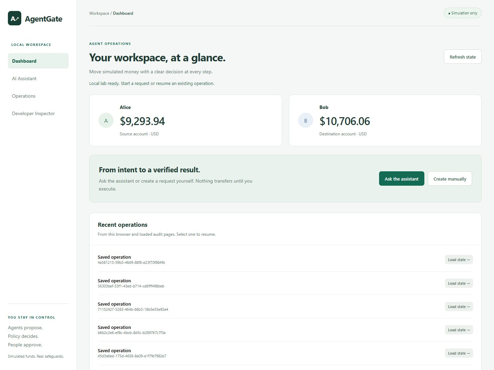
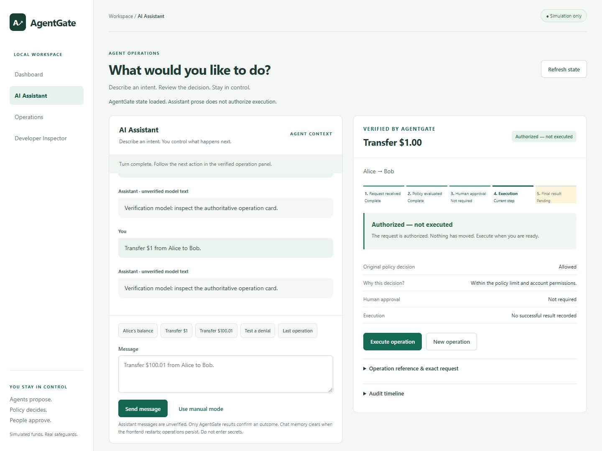
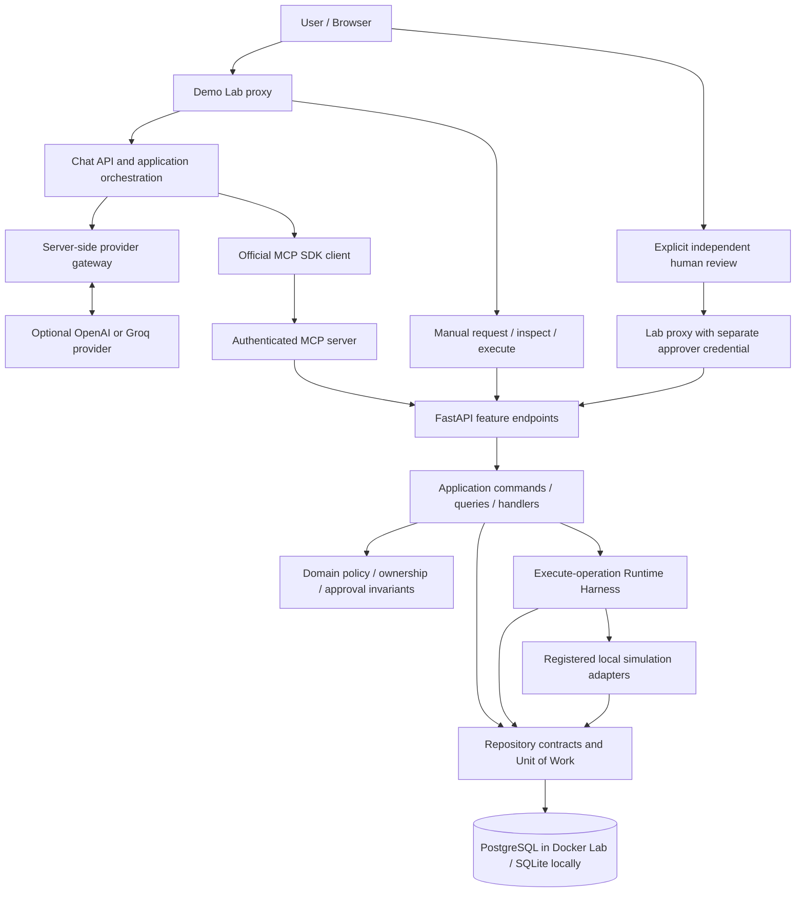
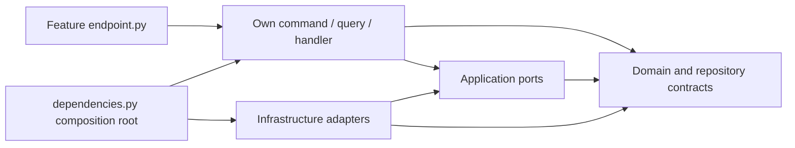
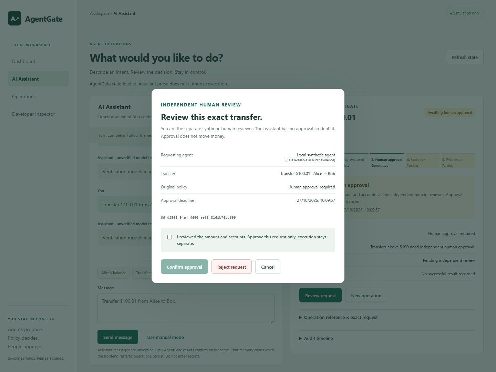

# AgentGate — Secure AI Agent Execution, Beyond Tool Calling

[](https://github.com/danillofratta/agentgate-sdd/actions/workflows/ci.yml)
[](pyproject.toml)
[](LICENSE)

A simulation-first reference architecture for AI agents that request financial
operations through MCP while deterministic policies, human approval, idempotency
and an auditable runtime harness control what actually executes.

**Watch an intent become a policy decision, an independent approval and a stored
receipt.** Agents propose, policy decides, people approve, and the harness
executes only an authorized operation. **Transfers are simulated. No real funds
are moved.**

[Start the browser lab](#quick-start-docker-compose) ·
[Explore the architecture](#architecture) ·
[Review the evidence](docs/milestone_c_verification.md)



Real browser capture from the local PostgreSQL lab. No real funds or provider
calls were used. [Assistant and human review screenshots](docs/media/README.md).

## Why AgentGate exists

Tool calling gives a model a way to request an action. A financial workflow also
needs answers to harder questions: Who owns the request? Does current policy
allow it? Has the exact intent been approved? Did a timed-out call already commit?
Can we replay it without another debit?

AgentGate turns those questions into deterministic application and domain
controls. The model is an untrusted proposer; persisted results establish what
happened. Engineers can demonstrate and inspect the safeguards without connecting
to a bank or paying for an AI provider.

## Interactive demo



Captured with the explicit deterministic test model and real MCP/API/PostgreSQL;
this image does not demonstrate live provider interoperability.

Dashboard shows Alice and Bob's synthetic USD balances and recent-operation
links. AI Assistant and Operations share one authoritative operation panel, with
a five-stage lifecycle, deliberate human review and stored receipts. Developer
Inspector exposes sanitized HTTP/MCP evidence when expanded.

Try these journeys in **Create manually**, or use the matching assistant prompt
after configuring an optional provider:

| Intent | Expected behavior with permitted, funded accounts |
| --- | --- |
| “What is Alice's balance?” | A balance operation; chat can execute this non-financial lookup automatically. |
| “Transfer $1 from Alice to Bob.” | ALLOW; **Authorized — not executed** until you choose Execute operation. |
| “Transfer $100.01 from Alice to Bob.” | REQUIRE_APPROVAL; independent review, then separate execution. |
| “Transfer $1,000.01 from Alice to Bob.” | DENY; no execution. |
| “What happened to my last operation?” | Inspect persisted state; replay a completed ID to retrieve its original result. |

The [lab walkthrough](docs/interactive_lab.md#guided-operations-console) covers
rejection, audit pagination, restart recovery and uncertain outcomes. Funds and
source permissions always remain part of policy evaluation.

## Key engineering capabilities

- **Deterministic authorization:** strict integer cents, allowlisted tools,
  ownership and current account facts; missing context and policy errors deny.
- **Independent human approval:** grants bind the operation, owner, immutable
  arguments, policy version and original deadline. Approval never executes.
- **Bounded runtime execution:** revalidation, fixed local adapters, cooperative
  deadlines, bounded retry and conservative uncertain-commit recovery.
- **Transactional evidence:** balances, result, approval consumption and success
  audit commit atomically; read-only inspection adds no audit writes.
- **Durable idempotency:** principal-scoped submission keys and stored terminal
  results prevent another debit on replay, including after restart.
- **Explicit trust boundaries:** real official-SDK MCP transport, server-side
  provider credentials, validated output and separate human controls.

## Architecture

These arrows show **runtime calls**, including the separate manual and human
paths. PostgreSQL backs the persistent Docker Lab; SQLite is the alternative local
runtime. The LLM has no SQL, database or approval interface.



**AI → MCP → Application → Domain → Infrastructure boundaries:** orchestration
validates suggestions and invokes fixed MCP use cases. MCP forwards to the API.
Feature handlers enforce authorization even when called directly; pure domain
rules decide what is permitted. Repositories and simulation adapters implement
inward-facing contracts. Only the execution harness dispatches business tools;
submission and human approval never dispatch.

Source dependencies point inward, separately from the runtime diagram:



DDD, CQRS, Vertical Slice and Hexagonal Architecture coexist in one modular
monolith. Each use case owns its endpoint and handler. Commands and read-only
queries share one selected database; there is no mediator, event bus, event
sourcing or separate CQRS database. See [architecture](docs/architecture.md).

## Runtime Harness and security guarantees

The harness accepts an operation ID, rechecks the owner, policy, current funds
and approval, and dispatches only `get_balance` or `simulate_transfer`. Effects
commit with their durable result and success audit. Execution accepts no
replacement transaction arguments.

A two-second cooperative budget covers at most two attempts sharing one deadline,
with retry delay capped at 50 ms. Only classified transient locks with proven
rollback retry. Uncertain commits require durable reconciliation before another
dispatch. This is local transactional correctness, not a distributed exactly-once
guarantee. See [runtime harness](docs/execution_harness.md).

## Human-in-the-Loop demonstration



1. Propose **$100.01 · Needs approval** from Alice to Bob.
2. Inspect **Awaiting human approval** and unchanged balances.
3. Choose **Review request**, check the exact intent and confirm as the separate
   synthetic reviewer. Approval changes the next action; it moves no money.
4. Choose **Execute approved transfer** to receive the stored receipt.
5. Choose **Replay safely**: the original result returns without another debit.

Typing “I approve” into chat grants no authority. MCP exposes exactly
`request_operation`, `get_operation` and `execute_operation`; approval is absent
from agent tools. The single-user lab cohosts human controls in a trusted proxy:
it demonstrates independent credentials, not production human authentication.
See [approval details](docs/human_approval_walkthrough.md).

## Idempotency, replay and durable recovery

Identical submissions with the same principal/key return the original operation;
changed payloads conflict. Terminal execution replay retrieves the stored outcome.
PostgreSQL survives ordinary Compose stop/restart/down; startup seeds missing
accounts without resetting balances.

The console retains original recovery identity and requires deliberate
reconciliation after an uncertain response. It never silently creates another
transfer. Chat memory is bounded and process-local; business operations are
durable. If chat context is lost before an original ID can be recovered, mutations
remain blocked rather than guessing. Retain IDs and inspect persisted state
before creating another intent. See [persistence](docs/persistence.md) and
[lab recovery](docs/interactive_lab.md#persistence-and-recovery).

## Development Harness — OpenSpec and SDD

OpenSpec proposals, designs, scenarios, tasks and evidence make changes reviewable.
The workflow is **propose → review → apply → verify**; archival requires a separate
request. [AGENTS.md](AGENTS.md) and executable architecture tests enforce inward
imports, feature-local endpoints and constructor injection.

The [Milestone C matrix](docs/milestone_c_verification.md) distinguishes offline
fake-provider tests, real SDK protocol checks, historical Docker/CI evidence and
the user-reported Groq demonstration. The latter is not an automated provider
smoke-test pass. [Portfolio verification](docs/portfolio_finalization_report.md)
records this maintenance increment and archive readiness.

## Technology stack

| Area | Implementation |
| --- | --- |
| Backend | Python 3.12, FastAPI, Pydantic, Uvicorn; locked uv dependencies |
| Persistence | PostgreSQL 16 with Psycopg in Docker Lab; SQLite alternative |
| Agent transport | Official pinned MCP Python SDK 2.3.0, Streamable HTTP |
| Optional AI | Server-side OpenAI-compatible Chat Completions for OpenAI or Groq |
| Browser | Vanilla HTML/CSS/JavaScript; shared operation workspace |
| Verification | Pytest, architecture tests, Node frontend tests, Ruff, strict Mypy, OpenSpec, GitHub Actions |

## Quick start: Docker Compose

Install Docker Desktop with Linux containers and Compose v2. From the repository
root, run in Windows PowerShell:

```powershell
powershell -NoProfile -ExecutionPolicy Bypass -File .\scripts\start_lab.ps1
```

The script generates distinct local file secrets, builds and starts the lab,
waits for health checks and retains PostgreSQL data. **No provider key is needed
for manual mode.** Initial setup downloads images/packages.

| Local entry point | URL |
| --- | --- |
| Browser lab | <http://127.0.0.1:8080> |
| Swagger / OpenAPI | <http://127.0.0.1:8001/docs> / <http://127.0.0.1:8001/openapi.json> |
| MCP Streamable HTTP | <http://127.0.0.1:8002/mcp> |

Keep these ports free. Services bind to loopback; PostgreSQL publishes no port.
Swagger is explicitly enabled for the lab and disabled in the default API.
Stop with `docker compose stop`; resume with `docker compose up -d --wait`.
Retain the named data volume and `.lab-secrets` together. See the
[full lab guide](docs/interactive_lab.md) for setup and recovery details.

**Optional provider:** store your own key in ignored `.lab-secrets/llm_api_key`,
set `AGENTGATE_LLM_PROVIDER` to `openai` or `groq`, choose a tool-capable
`AGENTGATE_LLM_MODEL`, then restart through the startup script. Only the matching
official provider origin is accepted; arbitrary compatible server URLs are not
supported. The capability probe and chat requests may incur charges and send
conversation context off-host. Never enter real financial/personal data or
secrets. Follow the [provider configuration instructions](docs/interactive_lab.md#ai-chat-provider-configuration)
for safe key entry, limits and opt-in verification.

For a Python-only server and detailed HTTP examples, use the
[secondary SQLite/HTTP guide](docs/sqlite_http_development.md).

## Tests, Swagger and MCP inspection

Install Python 3.12, uv 0.12.5 or newer and Node.js (CI's OpenSpec toolchain uses
22.16.0). Run from the repository root:

```powershell
npm install --global --ignore-scripts --no-audit --no-fund @fission-ai/openspec@1.14.3
uv sync --project backend/services/agentgate --locked --python 3.12
uv run --project backend/services/agentgate --locked pytest backend/services/agentgate/tests
node --test frontend/apps/lab-console/tests/console.test.cjs
uv run --project backend/services/agentgate --locked ruff check --config backend/services/agentgate/pyproject.toml backend/services/agentgate tests/e2e
uv run --project backend/services/agentgate --locked ruff format --check --config backend/services/agentgate/pyproject.toml backend/services/agentgate tests/e2e
uv run --project backend/services/agentgate --locked mypy --strict backend/services/agentgate/src
openspec validate --all --strict
git diff --check
```

Ordinary tests block outbound network and subprocesses and use fake time,
fake providers and temporary SQLite databases. Protocol tests use the real MCP
SDK over in-memory ASGI transports. PostgreSQL/container tests are separate,
explicit [CI gates](.github/workflows/ci.yml). The badge refers to the linked
branch's hosted run, not every local experiment.

Swagger lets you inspect schemas; it never injects credentials. For official-SDK
MCP discovery against the running lab:

```powershell
uv run --project backend/services/agentgate --locked python tests/e2e/mcp_client.py list
```

The client reads the local MCP secret without printing it. See
[MCP examples](docs/interactive_lab.md#mcp-server-and-official-sdk-client) and
[MCP evidence](docs/milestone_b_verification.md) for invocation and restart checks.

## Security boundaries and limitations

| Category | Scope |
| --- | --- |
| Implemented controls | Deterministic policy, immutable approval, explicit execution, strict schemas, atomic local effects/audit, durable replay, bounded model calls and server-side credentials. |
| Tested guarantees | Specified policy boundaries, direct-handler authorization, adversarial model/tool output, provider failures, ownership, concurrency/replay and rollback; exact evidence is linked below. These tests do not prove general prompt-injection immunity. |
| Demonstration limitations | Two synthetic accounts, one agent and one approver identity, trusted local host/clock/database administrator; bounded process-local chat and browser recovery context. |
| Production work remains | Multi-user identity/OAuth, TLS deployment, credential rotation, per-user rate limits, externally witnessed audit, distributed side-effect reconciliation and capacity validation. |

Audit is transactional, not tamper-proof. Deadlines are cooperative; entered
COMMIT and connection establishment are not hard real-time interruptible.
There is no application-owned structured logging pipeline; redaction tests cover
specified paths rather than every host/proxy configuration. Model prose can be
wrong. No certification, external security audit, performance benchmark or banking
production readiness is claimed. Read the [threat model](docs/threat_model.md).

## Technical documentation

- [Architecture and dependency rules](docs/architecture.md)
- [Runtime execution harness](docs/execution_harness.md)
- [Interactive lab and provider setup](docs/interactive_lab.md)
- [Human approval walkthrough](docs/human_approval_walkthrough.md)
- [Persistence and recovery](docs/persistence.md)
- [Threat model](docs/threat_model.md)
- [Requirements traceability](docs/requirements_traceability.md)
- [Milestone A](docs/milestone_a_verification.md), [B](docs/milestone_b_verification.md) and [C verification](docs/milestone_c_verification.md)
- [UX acceptance and outstanding checks](docs/interactive_lab_ux_acceptance.md)
- [Portfolio finalization and archive readiness](docs/portfolio_finalization_report.md)

## License

[MIT](LICENSE).

## Monorepo ownership

| Path | Owner |
| --- | --- |
| `backend/services/agentgate/` | Python modular monolith: API, Lab BFF and MCP processes, unit/integration tests and locked packaging |
| `frontend/apps/lab-console/` | Independently built vanilla JS console and unprivileged Nginx; no Python or secrets |
| `tests/e2e/` | Browser and cross-process acceptance scripts |
| `infra/` | Deployment infrastructure; Compose entrypoints remain at root |
| `docs/`, `scripts/`, `openspec/`, `.github/` | Repository-wide documentation, startup, specifications and CI |

Nginx owns the browser URL and proxies `/lab/*` to `lab-bff`. Only backend
processes mount credentials. The BFF retains JSON routes, session/CSRF validation
and chat orchestration. See [refactor verification](docs/enterprise_monorepo_verification.md)
and [file mapping](openspec/changes/refactor-enterprise-monorepo/design.md).
