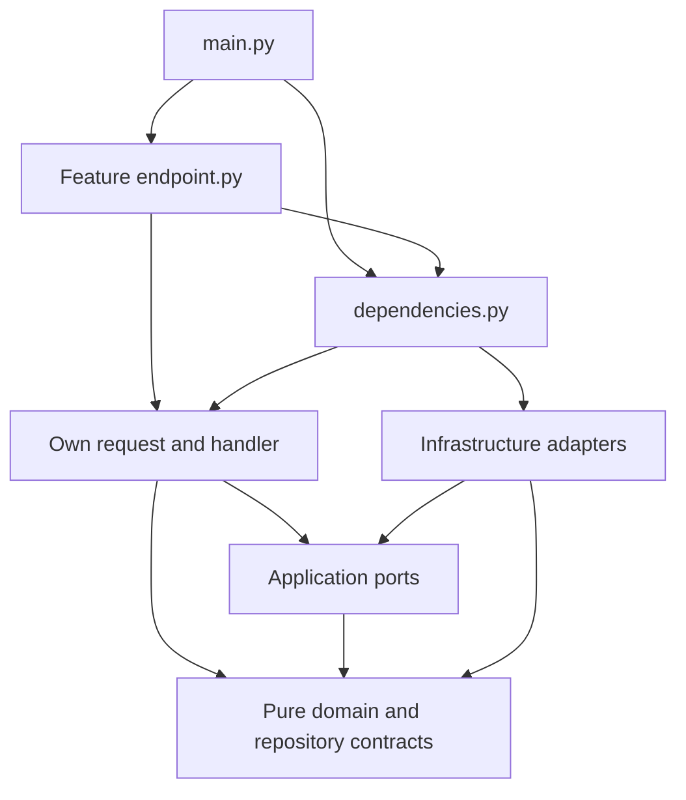
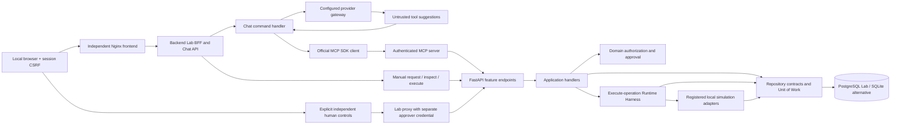

# Architecture

AgentGate is one bounded context in one modular monolith. DDD isolates business
invariants, CQRS makes write intent explicit, Vertical Slice keeps each use case
together, and Hexagonal Architecture protects the core from concrete I/O.
These conventions use Python types and Protocols without additional frameworks.

## Layout

```text
backend/services/agentgate/src/agentgate/
  main.py                       FastAPI factory and router registration
  dependencies.py               sole concrete composition/DI root
  components.py                 typed bundle of constructed collaborators
  domain/
    entities/                   Account, Operation, Approval
    value_objects/              immutable IDs, money, principal, requests, snapshots
    enums/                      Role, Tool, Decision, Reason, approval/operation states
    policies/                   pure operation_policy evaluation
    repositories/               persistence/read contracts using domain types
    events/                     immutable facts, no event delivery
    exceptions/                 typed invariant failures
  application/
    ports/                      UoW, policy, identity, tools, clock, sleeper, IDs
    exceptions/                 orchestration/storage failures
    execution_deadline.py        injected monotonic deadline
  features/
    request_operation/          endpoint, models, command, handler, result
    approve_operation/          endpoint, models, command, handler, result
    execute_operation/          endpoint, models, command, handler, result, harness
    get_operation/              endpoint, models, query, handler, result
    list_audit/                 endpoint, models, query, handler, result
    evaluate_policy/            internal query and handler
    expire_approval/            internal command and handler
  infrastructure/
    repositories/               SQLite implementations and row mapping
    persistence/                schema v6, connection, UoW, explicit seed
    gateways/                   local credentials/principals and fixed registry
    tools/                      two local simulation adapters
    runtime/                    real clock, sleeper, UUID generator
    security/                   trusted environment settings
  transport/                    shared body limit and sanitized HTTP errors
tests/
  domain/ application/ infrastructure/ api/ architecture/
```

Each Entity, Value Object/enum, policy class and contract has its own snake_case
module matching its full class name. Feature classes use role filenames; HTTP
schemas for one feature may share `models.py`. Package initializers define no
classes. Endpoints belong exclusively in their slice's `endpoint.py`; there is
no centralized `api/routes/` or `controllers/` directory.

## Allowed import matrix

Rules include relative, aliased, type-only and re-export imports. The dependency
graph must remain acyclic.

| Area | Allowed project dependencies and external dependencies | Boundary |
| --- | --- | --- |
| `domain/` | Domain and standard library | No I/O, environment, real clock reads, frameworks, SQLite or third-party library |
| `application/ports`, exceptions, deadline | Domain and application abstractions | No feature implementations or concrete adapters |
| Feature command/query/handler/result/harness | Domain, application abstractions, own non-HTTP slice | No sibling slices, HTTP, Pydantic, concrete adapters or root DI |
| Feature `endpoint.py` | Own schemas/request/handler, domain values, DI providers; FastAPI | No SQL, concrete storage or tool dispatch |
| Feature `models.py` | Own HTTP schemas; Pydantic | No business classes |
| `infrastructure/` | Domain and application abstractions; standard library I/O | No features, transport, bootstrap or DI imports |
| `transport/` | Shared inward errors/types; HTTP libraries | No business routes or concrete adapters |
| `dependencies.py` | Contracts, handlers and concrete adapters; FastAPI providers | Sole concrete constructor wiring exception; no business rules, SQL or dispatch |
| `main.py` | Components, DI, shared HTTP configuration and feature routers; FastAPI | Bootstrap only |



[`tests/architecture`](../backend/services/agentgate/tests/architecture) checks import direction, cycles,
class/file organization, CQRS, hidden dependency resolution and dispatch placement.
AST checks are regression gates, not a sandbox against hostile Python packages.

## Command/Query/Handler map

Each request lives in its slice's `command.py` or `query.py`, and each handler
in its own `handler.py`.

| Slice | Request | Handler | HTTP / responsibility |
| --- | --- | --- | --- |
| request_operation | RequestOperationCommand | RequestOperationHandler | POST /operations; idempotent creation, policy, pending approval and audit |
| approve_operation | ApproveOperationCommand | ApproveOperationHandler | POST /operations/{id}/approval; one independent grant/reject and audit |
| execute_operation | ExecuteOperationCommand | ExecuteOperationHandler | POST /operations/{id}/execute; owner authorization, harness, attempts, recovery and replay |
| get_operation | GetOperationQuery | GetOperationHandler | GET /operations/{id}; owner/approver inspection |
| list_audit | ListAuditQuery | ListAuditHandler | GET /audit; approver-only bounded inspection |
| evaluate_policy | EvaluatePolicyQuery | EvaluatePolicyHandler | Internal pure query on supplied trusted facts; no endpoint or writes |
| expire_approval | ExpireApprovalCommand | ExpireApprovalHandler | Internal explicit atomic expiry and audit; no endpoint, worker or scheduler |

Queries never change balances, operations, approvals, results, expiry or durable
audit. Read repositories use read-only connections to the same SQLite database.
`get_balance` dispatch is an execution command, distinct from inspection.
There is no mediator, event bus, event sourcing or asynchronous projection.
Domain event values describe facts; `AuditRepository` persists evidence in a
transaction. Creating an event does not publish it or prove its commit.

## Contracts and constructor wiring

All six persistence contracts live in
[`domain/repositories/`](../backend/services/agentgate/src/agentgate/domain/repositories): `AccountRepository`,
`OperationRepository`, `ApprovalRepository`, `AuditRepository`,
`OperationReadRepository` and `AuditReadRepository`. Methods use domain types,
never HTTP schemas, feature results or SQL rows. Implementations live in
[`infrastructure/repositories/`](../backend/services/agentgate/src/agentgate/infrastructure/repositories).

Actual application port names are `RequestUnitOfWork`, `RequestUnitOfWorkFactory`,
`PolicyEvaluatorGateway`, `CredentialGateway`, `PrincipalGateway`,
`ToolRegistryGateway`, `ClockGateway`, `SleeperGateway` and
`OperationIdGeneratorGateway`. No generic CRUD contract or unused publisher is
required. Local audit is persistence, not event publication.

This executable excerpt follows
[`build_components`](../backend/services/agentgate/src/agentgate/dependencies.py). It illustrates root wiring;
handlers must not import these concrete adapters:

```python
from agentgate.features.evaluate_policy.handler import EvaluatePolicyHandler
from agentgate.features.request_operation.handler import RequestOperationHandler
from agentgate.infrastructure.persistence.sqlite_unit_of_work import SqliteUnitOfWork
from agentgate.infrastructure.runtime.system_clock import SystemClock
from agentgate.infrastructure.runtime.uuid_operation_id_generator import (
    UuidOperationIdGenerator,
)

database = "agentgate.sqlite3"
request_handler = RequestOperationHandler(
    lambda: SqliteUnitOfWork(database),
    EvaluatePolicyHandler(),
    SystemClock(),
    UuidOperationIdGenerator(),
)
```

Request and execute handlers accept the policy port; only root DI knows its
implementation is the evaluation handler. Slices never import one another.
Tests substitute fake ports and explicit principal/time values without FastAPI
or SQLite. FastAPI `Depends` stays in endpoints and root providers. Handlers
enforce authorization when HTTP is bypassed; an alternate adapter must obtain
trusted principal context rather than trust caller-asserted roles.

## Execution Harness and Unit of Work

The handler owns transaction attempts, persisted attempt evidence, identity
refresh, terminal replay and recovery. Its slice-local `Harness` alone invokes
`ToolRegistryGateway.dispatch`, revalidates policy/funds/approval, checks the
deadline, validates results and applies account transitions. Tool adapters receive
immutable arguments/account snapshots without a database or commit handle.
The harness applies `Account.transfer_to` and saves through the current UoW.

The UoW shares one connection among account, operation, approval and audit
repositories. SQLite `BEGIN IMMEDIATE`, uniqueness/conditional updates and
nonnegative integer balance constraints protect local concurrency. Balances,
result, approval consumption, dispatch and success audit commit together.
Attempt evidence commits before dispatch in a separate transaction; rolled-back
attempts remain visible. Terminal failure recording follows confirmed rollback
in a separate bounded recovery transaction. Storage failure can prevent terminal
evidence; the application does not invent durable success or audit records.

Two seconds of monotonic time cover at most two attempts and one retry delay of
at most 50 ms. Only proven rolled-back transient locks retry, without resetting
the deadline. Unknown/authorization/validation failures do not retry. Uncertain
commits require durable reconciliation before later dispatch. Scheduling and an
entered commit/fsync are not hard real-time interruptible; committed results
are reported truthfully. See [execution](execution_harness.md) and
[persistence/recovery](persistence.md).

## Lab and agent integrations

Milestone A's optional PostgreSQL deployment and local browser adapters are
described in [interactive lab](interactive_lab.md). One configured database still
serves commands and queries. Local mode additionally registers the approver-only
account query and Swagger; the default API surface remains unchanged. `lab.py`
bootstraps the separate backend Lab BFF; `dependencies.py` remains its concrete
gateway composition root. All routes stay in feature `endpoint.py` modules.

Milestone B's `mcp.py` bootstraps a separate official-SDK Streamable HTTP server.
Its feature-local `mcp_ingress/endpoint.py` exposes exactly three tools, performs
strict transport-schema validation and delegates fixed HTTP calls through
`McpApiGateway`. `LocalMcpApiGateway` holds only the AGENT token and calls the
existing FastAPI endpoints; `dependencies.py` constructs it and its HTTP client.
It has no approval method, persistence access or direct dispatch. There are no
new business handlers or business rules: API CQRS handlers and the harness
remain authoritative. `McpSecurity` authenticates the separate inbound token
and rejects hostile/duplicate Host/Origin/authorization headers before the SDK.
The SDK manages protocol compatibility and lifespan; PostgreSQL owns replay.
All local MCP clients map to one synthetic agent, not independent OAuth users.
See [MCP verification](milestone_b_verification.md).

Milestone C adds the `chat_turn` command slice to `lab.py`. Its framework-free
handler constructor receives `LlmGateway`, `AgentMcpGateway`,
`ChatSessionsGateway` and `OperationIdGeneratorGateway`. Concrete wiring remains
in `dependencies.py`. `OpenaiChatGateway` speaks configured OpenAI-compatible
Chat Completions over HTTPS; `SdkAgentMcpGateway` uses the installed official MCP
client over Streamable HTTP. It never calls FastAPI directly. Every financial
execution still reaches the existing Runtime Harness. There are no new business
tools, policy rules or repositories.



The MCP server exposes three tools. Model-facing definitions project submission
into `request_balance` and `request_transfer`, alongside `get_operation` and
`execute_operation`: four validated model functions map to the three unchanged
MCP schemas. Submission keys belong to the backend. A pending mutation retains its
exact key/arguments across timeout/cancellation and explicit recovery. A transfer
execute command grants only one invocation for that exact known ID; user text
cannot create this grant or satisfy business approval. Balance reads may execute
automatically. Human approve/reject is absent from all agent/model ports.

Chat sessions are process-local, capped, time-limited and isolated by the lab's
signed session boundary. Only PostgreSQL business operations are durable. The
browser shows model prose as unverified, separate from validated MCP operation
cards, status, decisions and tool events. Tool results are data, never system
instructions. Provider/MCP credentials remain server-side. The proxy process is
trusted and cohosts the existing manual human workflow; production multi-user
identity and process isolation remain outside the local lab.

Provider function-calling support is probed before business use, with bounded
calls, context, tokens, timeouts and response size. No model framework, recursive
dispatch, arbitrary network tool or new public port is introduced. See
[C verification](milestone_c_verification.md) for limits, fake-provider protocol
coverage and the separately opt-in real-provider test. Inbound adapters never
provide policy overrides, replacement approved arguments or direct tool/database access.
A future outbound integration would
implement an application `Gateway` under infrastructure; persistence remains a
domain `Repository`. Add an `EventPublisher` only for a real publishing use case.

Remote side effects require a separately reviewed specification for external
idempotency, cancellation, reconciliation and distributed failures. Local SQLite
atomicity is not a production-grade distributed transaction. No remote service,
paid service is required by the manual/MCP deployment. Optional AI chat uses a
separately configured paid provider and sends bounded conversation context to it.

## Build and ownership boundaries

The Python root is `backend/services/agentgate/`. All source paths above are
relative to that project. Browser assets belong to `frontend/apps/lab-console/`,
which builds without Python; Python builds without browser assets. Root Compose
owns process orchestration and persistent volumes, `infra/` owns deployment
infrastructure and `tests/e2e/` owns cross-application acceptance.
Nginx holds no credentials; only the BFF adapts browser JSON requests to trusted
server-side identities. Proxying preserves the original Host/Origin and CSRF
context and never retries upstream mutations.

## Domain type classification

`domain/enums/` owns `ApprovalDecision`, `ApprovalState`, `Decision`,
`OperationState`, `Reason`, `Role` and `Tool`. Each has its original StrEnum
members and serialized string values, with a single canonical definition.
`domain/value_objects/` retains `Principal`, IDs, `Money`, `OperationRequest`,
`BalanceResult`, policy/approval/account snapshots, inspection and audit facts.
Their names do not turn them into HTTP DTOs. Feature `models.py` owns transport
schemas; feature `command.py`, `query.py` and `result.py` retain CQRS data types.
Repository mappers hydrate the same enum values; neither database schema nor
fingerprint encoding changes. Architecture tests reject enum misplacement.
