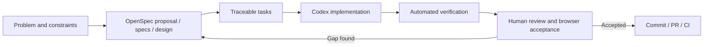
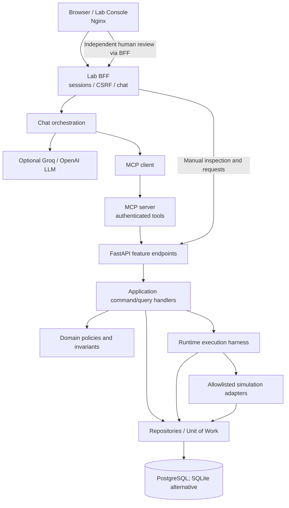

# AgentGate — Engineering AI Agents with SDD, MCP and Runtime Harnesses

> **Engineering case study · October 2026**  
> **Repository:** [danillofratta/agentgate-sdd](https://github.com/danillofratta/agentgate-sdd)  
> **Scope:** simulation-first reference implementation; **no real funds are moved**.

## Executive summary

**AgentGate explores two connected engineering problems:** how to build complex software with AI coding assistance *without losing architectural control*, and how to allow an AI agent to request business operations *without giving the model execution authority*.

I used **Spec-Driven Development (SDD)** with OpenSpec and an AI coding assistant (Codex) to develop a modular Python application, an MCP server, a browser-based lab, and deterministic execution safeguards. The important engineering work was not merely producing source code: it was defining boundaries, reviewing implementation against specifications, finding failure modes, and proving behavior through tests and manual scenarios.

At runtime, an optional language model interprets a user's request and proposes operations using the **Model Context Protocol (MCP)**. The application independently authenticates the caller, evaluates policy, binds human approval to an exact operation when required, and executes a simulated financial action through a bounded **Runtime Harness**. The model cannot substitute its own text for authorization or claim that money moved.

**Core thesis:** *AI can propose an action; only trusted application logic can authorize and execute it.*

### The two harnesses

| Development Harness | Runtime Harness |
|---|---|
| Controls **how we build** with AI assistance | Controls **what AI-requested operations can do** |
| OpenSpec proposals, specifications, design and tasks | Validated requests, policy evaluation, human review |
| `AGENTS.md`, architectural rules, review gates | Explicit execution authority, bounded retries and deadlines |
| Automated tests, CI and human verification | Durable idempotency, reconciliation and audit evidence |
| Reduces implementation drift | Reduces unsafe side effects and ambiguous outcomes |

These harnesses serve different purposes and should not be conflated.

## 1. The problem

Connecting an LLM to tools is straightforward. The deeper problem is controlling the consequences of the tool calls:

- Who requested this operation, and which accounts may that caller access?
- Does the current business policy allow this *exact* operation?
- If approval is required, who may approve it, and what precisely are they approving?
- If a timeout occurs, did the operation commit before the response was lost?
- Can the original request or execution be replayed without a second debit?
- Can an engineer reproduce the intended behavior from specifications and tests?

A simulated wallet-transfer domain makes these questions concrete without using a bank connection or real customer funds.

## 2. Engineering goals and non-goals

**Goals**

1. Implement deterministic policy and authorization independently from model output.
2. Keep submission, approval and execution as distinct operations.
3. Expose a small, authenticated MCP capability surface.
4. Make financial intent durable and replay-safe.
5. Keep the domain isolated from HTTP, model-provider SDKs and persistence adapters.
6. Make implementation decisions inspectable through OpenSpec, code review and regression tests.
7. Provide a browser lab that exposes the operation lifecycle without requiring familiarity with MCP internals.

**Explicit non-goals**

- Real transfers or production banking readiness.
- Unrestricted autonomous action or arbitrary code/tool execution.
- A general-purpose multi-agent platform.
- A claim of universally effective prompt-injection defense or distributed exactly-once semantics.
- A requirement for microservices, an event bus, event sourcing, or separate CQRS databases.

## 3. Development Harness — implementing with SDD and Codex

The development workflow treats specifications and verification as durable project artifacts, rather than relying on a long conversation prompt as the sole source of truth.

**How the workflow was used:**

- Requirements described the permissible operation states, security boundaries, contracts and acceptance scenarios.
- Architecture instructions in [`AGENTS.md`](../AGENTS.md) constrained dependencies, naming, layer ownership and test expectations.
- The implementation was broken into changes and tasks rather than being generated in one step.
- Tests exercised ordinary flows and adversarial outcomes such as duplicate requests, model-originated approval claims, stale sessions and uncertain outcomes.
- Manual browser acceptance checked the user-visible operation lifecycle, which static OpenSpec validation alone cannot prove.

### A concrete example: a defect found after the UX redesign

A review found that an unsuccessful session/CSRF reconciliation could discard the original recovery identity. That is not simply a UI issue: regenerating an idempotency key before resolving a possibly committed request can create a **new business intent**.

Other findings included permitting new chat submissions while a financial result was uncertain, and allowing an audit-read failure to obscure an otherwise confirmed operation.

The response was to refine failure/recovery scenarios, add focused regression tests, and preserve the principle that **only authoritative reconciliation of the original operation clears financial uncertainty**. This is the practical value of SDD: specifications, implementation and tests are revised together when evidence exposes a gap.

**Engineering ownership:** AI coding assistance accelerated implementation. Architectural decisions, acceptance criteria, risk prioritization and acceptance remain human responsibilities. Generated code and passing tests do not eliminate the need to understand the handlers, invariants and failure paths.

## 4. Runtime architecture

The implementation is a **modular monolith** with DDD, CQRS, Vertical Slice and Hexagonal Architecture principles. The monorepo refactor groups the independent web console under `frontend/apps/` and the Python application under `backend/services/`; these are organizational and deployment boundaries, not a forced migration to microservices.

*Conceptual diagram. Follow the code for precise transport and process boundaries. The model has no direct database connection and cannot use a human approval tool.*

### Feature-level responsibilities

- **Endpoints and HTTP schemas:** transport parsing and response adaptation, owned by their feature.
- **Commands/queries and handlers:** use-case orchestration, including ownership checks and transaction boundaries.
- **Domain entities, policies, enums and value objects:** financial invariants, decisions and state transitions.
- **Repository contracts and gateway ports:** inward-facing abstractions for persistence, clocks, identity, provider and MCP interactions.
- **Infrastructure:** PostgreSQL/SQLite, authenticated transports, model gateway, MCP client and simulation adapters.
- **Composition root:** dependency injection wires implementations without making the domain depend on frameworks.

CQRS here means **separating command and query responsibilities**, not adding MediatR, two databases or an asynchronous bus.

## 5. One request, end to end

A user asks: **“Transfer $100.01 from Alice to Bob.”**

1. The chat orchestrator interprets the message and proposes a structured tool call.
2. The MCP client invokes an authenticated server capability that forwards the proposal to the application.
3. The request handler checks the principal and the principal-scoped idempotency key. If the same request already exists, it returns the original operation; if the key is reused for a different request fingerprint, it rejects the conflict.
4. The deterministic policy evaluates the actual operation, current facts and permissions; it does **not** trust a model's declaration that an operation is allowed.
5. Under the documented demonstration thresholds and suitable account conditions, a transfer of **$100.01** requires independent human approval.
6. The reviewer approves the exact saved intent through a separate human-authenticated path. **Approval does not execute the transfer.**
7. An explicit execution request invokes the Runtime Harness with the existing operation ID—not a new amount or destination supplied by a model.
8. The harness rechecks relevant conditions, invokes the registered simulation adapter and commits effects plus durable result/audit according to the transaction model.
9. A replay returns the stored result without applying a second transfer.

The model's output is a **proposal**; persisted application state is the **source of truth**.

### Why fingerprints and idempotency keys are different

An idempotency key identifies the submission attempt in the caller's scope. A fingerprint represents the **canonical content** of that request. The same principal/key with changed destination, amount or other relevant arguments is a conflict, not an instruction to reinterpret the original transfer.

This is also why a timeout cannot be “fixed” by generating a fresh key and blindly resending the action.

## 6. The MCP boundary

The server exposes a deliberately small capability surface:

| MCP tool | Purpose |
|---|---|
| `request_operation` | Submit a business intent for deterministic validation and policy evaluation |
| `get_operation` | Inspect persisted state and result |
| `execute_operation` | Request execution of an existing operation; the application revalidates authorization |

**No MCP tool grants human approval.** The independent approval flow is intentionally not under agent authority. The implementation may expose model-friendly, validated tool shapes at the orchestration boundary, but the public MCP capabilities and backend guarantees remain distinct.

The MCP server is not a shortcut around the application layer. It is an integration boundary through which clients request defined business capabilities.

## 7. Runtime Harness — controlling effects

The Runtime Harness provides a controlled path from **authorized, persisted operation** to **simulated effect**:

- Dispatch only registered operations and adapters.
- Inspect persisted intent; do not accept replacement financial arguments at execution time.
- Re-evaluate relevant owner, policy, approval, state and funds conditions.
- Bound attempts and deadlines rather than retrying indefinitely.
- Distinguish failures known to have rolled back from uncertain commit outcomes.
- Reconcile uncertainty before attempting another potentially duplicative mutation.
- Persist the result and its relevant audit evidence transactionally with the local effect.

The documented local retry budget is small and controlled; these guarantees apply to the simulated transactional environment. They are **not a proof of globally exactly-once effects against arbitrary external payment providers**.

## 8. Security engineering and failure handling

Security here is primarily **architectural**, not a single content-moderation prompt:

| Threat or failure | Control in AgentGate |
|---|---|
| Model writes “I approved this” | Model text cannot produce human authorization |
| Model requests an unsupported tool | Strict tool capability and schema validation |
| Duplicate submission | Principal-scoped idempotency key and request fingerprint |
| Duplicate execute / replay | Durable operation identity and stored terminal result |
| Approval refers to stale/different intent | Approval is bound to saved operation details and deadline |
| Lost response / uncertain commit | Original recovery identity retained; safe reconciliation before mutation |
| Audit read temporarily fails | Audit visibility failure must not rewrite known financial state |
| Browser session or CSRF failure | Reject unsafe access while preserving unresolved operation identity |
| Model produces fabricated success text | UI uses authoritative API state for final operation outcome |

**Limits:** The demo uses synthetic identities, local trust assumptions and simulated balances. It is not a substitute for OAuth/multi-user authorization, production TLS, external side-effect reconciliation, red-team evaluation, tamper-resistant audit or load testing. Guardrails reduce specified risks; they do not make prompt injection impossible.

## 9. Architecture decisions and trade-offs

### Why a modular monolith?

One transactional boundary makes it easier to keep simulated balance changes, approval consumption, results and audit consistent. Splitting each responsibility into a microservice would introduce distributed consistency problems before the project needs that complexity. The enterprise monorepo structure permits future independent services without forcing them now.

### Why feature-local endpoints and DTOs?

The request schema, endpoint, command/query and handler belong to the same use case. Transport schemas are not confused with domain value objects. A domain `OperationRequest` represents an invariant-bearing business intention; a Pydantic HTTP request model represents a wire contract.

### Why deterministic policy instead of “LLM-as-judge”?

A language model may help interpret language, but granting access to money—even simulated money—needs explicit, inspectable, reproducible policy rules. This produces clearer failures, tests and audit trails.

### Why separate approval from execution?

A human decision may authorize a saved intent, but the execution boundary must still recheck current conditions. Approval is neither equivalent to execution nor a grant of direct agent authority.

### Why a separate frontend deployment and a BFF?

An independently built frontend avoids packaging HTML/JS inside the Python distribution. The server-side BFF continues to own session security, privileged credentials and provider calls. Separation of deployment must not move secrets into the browser.

## 10. Verification and evidence

Evidence types should be reported accurately:

1. **Static architecture and unit tests** validate specified dependency and domain rules.
2. **Frontend tests** validate UI state and recovery logic; simulated DOM tests do not replace all browser-accessibility checks.
3. **MCP protocol tests** verify documented tool boundaries using the installed SDK.
4. **PostgreSQL/Docker integration evidence** validates selected persistence, approval, restart and replay scenarios.
5. **Manual browser demonstrations** validate the guided workflow. Optional real Groq interaction was user-reported, not a substitute for an automated provider compatibility suite.

During the enterprise-monorepo refactor, the implementation report recorded **1,065 passing Python tests** and **43 frontend tests**, plus focused database and browser scenarios. These figures are **reported project verification results**, not benchmarks independently rerun for this article; the relevant CI run and verification document should be linked when the case study is published.

Further references:

- [Architecture and dependency rules](architecture.md)
- [Runtime Harness](execution_harness.md)
- [Milestone C verification](milestone_c_verification.md)
- [Enterprise monorepo verification](enterprise_monorepo_verification.md)
- [Contributor/agent instructions](../AGENTS.md)
- [OpenSpec](../openspec/)

## 11. What I learned

**AI-assisted coding is not the same as AI-owned engineering.** The most valuable work happens when ambiguous requirements, non-obvious failure states and boundaries are made explicit before—and then verified after—code generation.

Three lessons shaped the project:

1. **Specifications are hypotheses until exercised.** A checked task and passing happy-path tests did not catch every recovery failure; targeted review and regression scenarios did.
2. **Control must survive uncertainty.** A successful demo is not enough if a lost response, expired approval or restart changes the meaning of an operation.
3. **Agent autonomy must be scoped to the business risk.** In the wallet simulation, the model chooses a valid capability to request; trusted application code decides authorization and execution.

The project is a reference implementation and learning artifact, not a claim that every module was manually authored or that an AI coding assistant substitutes for engineering judgment.

## 12. Interview briefing — Senior/Staff AI Engineer or Software Architect

Use these questions to prepare concise, code-grounded answers.

**Q: What is the most important architectural decision?**  
**A:** Separating model proposals from deterministic business authority. The MCP path does not bypass feature handlers, policy, human approval or the Runtime Harness.

**Q: Why is this more than a tool-calling demo?**  
**A:** A proposal gets an identity, ownership context, policy decision and durable lifecycle. Execution is explicit and replay-safe; approval is independent and cannot be fabricated in model output.

**Q: How did you use SDD rather than just prompting Codex?**  
**A:** Defined OpenSpec changes with requirements, scenarios, design and tasks; constrained implementation via `AGENTS.md` and architecture tests; compared code with specification; converted review findings into regression tests; validated through CI and manual acceptance.

**Q: What did AI coding assistance do, and what did you own?**  
**A:** Codex accelerated implementation and test generation. I established architecture and acceptance constraints, reviewed outcomes, challenged layer placement and frontend coupling, and directed remediation. I also treat deep code understanding as ongoing engineering work rather than assuming generated code is automatically understood.

**Q: What if the HTTP response is lost after COMMIT?**  
**A:** Reconcile the original operation using its identity and durable state; do not create a new key or repeat an uncertain side effect blindly. Distinguish known rollback from unknown commit outcomes.

**Q: Why not use microservices and asynchronous messaging?**  
**A:** Atomicity and comprehensibility are more valuable here. The modular monolith has clear boundaries; distributing transactions would add cost without proving a need.

**Q: What is missing for production?**  
**A:** Multi-user identity, deployment and credential hardening, external-provider reconciliation, quantitative model evaluations, capacity testing, external audit and ongoing threat modeling.

**Q: How would you evolve this into a multi-agent system?**  
**A:** Start with a measurable workflow requiring distinct responsibilities. Add bounded planner/researcher/reviewer roles, typed handoffs, shared trace and budget, and keep the same independent authorization/execution boundary. Compare it against a simpler single-agent baseline to show that more agents actually help.

### 60-second pitch

> I built AgentGate as a hands-on case study in two forms of AI governance. First, I used OpenSpec and Codex to develop a modular system with explicit architecture rules, acceptance scenarios and automated checks. Second, I designed an execution path where an LLM can request operations through MCP but never authorizes its own actions. Deterministic policy, independent human approval, durable idempotency and a bounded runtime harness control simulated financial effects. The point is not autonomous money movement; it is demonstrating how AI-assisted software development and AI-powered applications can remain observable, testable and controlled.

## 13. Next research directions — not current features

**Agent evaluation:** build reproducible datasets, tool-selection accuracy, task completion and error classification, latency/cost traces and adversarial tests.

**Bounded multi-agent orchestration:** give agents distinct responsibilities with typed task handoffs, budgets, step limits, checkpoints and an independent policy/approval gate. Introduce durable task state and compare against single-agent results. Do not grant a planner direct access to financial execution.

**Production integration:** explore external side-effect reconciliation and more robust identity and audit boundaries before describing any use case as production-ready.

---

**Recommended source-of-truth rule:** publish this case study only after cross-checking repository-relative paths, test counts and the latest merged branch. Screenshots and observed verification should be linked to actual repository artifacts. Do not present proposed multi-agent capabilities as already implemented.
