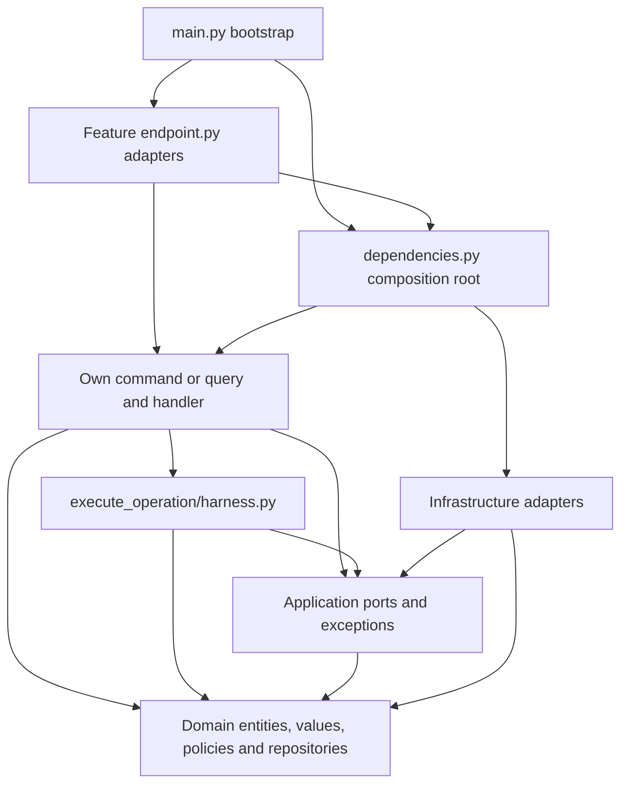

# Runtime execution harness

AgentGate executes two local SQLite simulations: `get_balance` and
`simulate_transfer`. No real money is moved. No external payment provider is
connected. MCP and LLM integrations are **not implemented**. The local SQLite
simulation is not a production distributed transaction system.

The handler-level boundary is wired in
[`dependencies.py`](../backend/services/agentgate/src/agentgate/dependencies.py) and exposed by the slice's
[`endpoint.py`](../backend/services/agentgate/src/agentgate/features/execute_operation/endpoint.py).
`POST /operations/{id}/execute` accepts an empty body. The HTTP adapter returns
stored/new success or durable FAILED/TIMED_OUT envelopes with status 200;
unavailable/uncertain storage returns sanitized 503. See the
[README HTTP demo](sqlite_http_development.md#http-demo) for all five routes.

## Architecture overview

All source paths below are relative to `backend/services/agentgate/src/agentgate/`.

| Component | Implemented responsibility |
| --- | --- |
| [`ExecuteOperationCommand`](../backend/services/agentgate/src/agentgate/features/execute_operation/command.py) | Immutable trusted `Principal` and `OperationId`; accepts no replacement arguments, policy, approval, or tool override. |
| [`ExecuteOperationHandler`](../backend/services/agentgate/src/agentgate/features/execute_operation/handler.py) | Enforces agent role/operation ownership, refreshes identity, owns transaction attempts, durable evidence, replay, failure recording, and commit reconciliation. Constructor-injects ports and constructs its own slice-local `Harness`. |
| [`Harness`](../backend/services/agentgate/src/agentgate/features/execute_operation/harness.py) | Owns the execution deadline and retry delay, prepares current authorization, dispatches the one requested tool, validates its result, applies account transitions, and stages success/approval/audit writes. Only this slice's harness invokes `ToolRegistryGateway.dispatch`. |
| [`Operation`](../backend/services/agentgate/src/agentgate/domain/entities/operation.py), [`Approval`](../backend/services/agentgate/src/agentgate/domain/entities/approval.py), [`Account`](../backend/services/agentgate/src/agentgate/domain/entities/account.py) | Immutable business snapshots with guarded lifecycle, approval binding/expiry/consumption, and integer-cent transfer invariants. Transitions return new values; they perform no I/O. |
| [`operation_policy.py`](../backend/services/agentgate/src/agentgate/domain/policies/operation_policy.py) | Pure policy over explicit trusted principal, request, and account facts; policy version `v1`. Permitted funded transfers of 1–10,000 cents allow, 10,001–100,000 require approval, and larger amounts deny. |
| [`ToolRegistryGateway`](../backend/services/agentgate/src/agentgate/application/ports/tool_registry_gateway.py) | Typed `dispatch(tool, arguments, accounts)` contract returning `BalanceResult` or `TransferArguments`; receives immutable values, no credentials, repositories, or commit handle. |
| [`LocalToolRegistryGateway`](../backend/services/agentgate/src/agentgate/infrastructure/gateways/local_tool_registry_gateway.py) | Fixed tool/type selection. [`GetBalanceAdapter`](../backend/services/agentgate/src/agentgate/infrastructure/tools/get_balance_adapter.py) returns a supplied account's balance; [`SimulateTransferAdapter`](../backend/services/agentgate/src/agentgate/infrastructure/tools/simulate_transfer_adapter.py) checks account presence and returns the exact transfer arguments. The harness, not the adapter, applies `Account.transfer_to` and persists both accounts. |
| [`RequestUnitOfWork`](../backend/services/agentgate/src/agentgate/application/ports/request_unit_of_work.py) / [`RequestUnitOfWorkFactory`](../backend/services/agentgate/src/agentgate/application/ports/request_unit_of_work_factory.py) | Transaction lifetime, deadline, rollback evidence, and domain-owned operation/account/approval/audit repository contracts. Repositories never commit independently. |
| [`SqliteUnitOfWork`](../backend/services/agentgate/src/agentgate/infrastructure/persistence/sqlite_unit_of_work.py) | One connection per transaction, `BEGIN IMMEDIATE`, shared repositories, explicit commit, rollback and close, and typed storage/deadline error classification. |
| [`database.py`](../backend/services/agentgate/src/agentgate/infrastructure/persistence/database.py) / [`SqliteAuditRepository`](../backend/services/agentgate/src/agentgate/infrastructure/repositories/sqlite_audit_repository.py) | One versioned SQLite database (current schema v6), conditional writes, nonnegative integer balances, principal/key uniqueness, structured transactional audit, and durable attempt-number allocation. |

DDD keeps invariants and repository contracts in `domain/`. CQRS separates
commands from read-only queries over the **same database**: executing even
`get_balance` is a command because it persists lifecycle evidence.
Vertical Slice keeps command, handler, harness, and result in
`features/execute_operation/`. Hexagonal boundaries use application ports for
policy, identity, tools, clock, sleeper, and transaction lifetime, with concrete
adapters under `infrastructure/`. There is no mediator, event bus, event sourcing,
separate read database, or background execution worker.

The following arrows show permitted project dependency directions. Framework DI belongs
only in endpoint adapters and root providers. `dependencies.py` is the sole
concrete composition root; handlers/domain never import concrete infrastructure.



Policy evaluation is injected through
[`PolicyEvaluatorGateway`](../backend/services/agentgate/src/agentgate/application/ports/policy_evaluator_gateway.py);
the execution slice never imports the sibling evaluation slice. Other injected
contracts are [`PrincipalGateway`](../backend/services/agentgate/src/agentgate/application/ports/principal_gateway.py),
[`ClockGateway`](../backend/services/agentgate/src/agentgate/application/ports/clock_gateway.py), and
[`SleeperGateway`](../backend/services/agentgate/src/agentgate/application/ports/sleeper_gateway.py).

## Complete execution lifecycle

[`OperationState`](../backend/services/agentgate/src/agentgate/domain/enums/operation_state.py) supports
`DENIED`, `PENDING_APPROVAL`, `READY`, `SUCCEEDED`, `REJECTED`, `EXPIRED`,
`FAILED`, and `TIMED_OUT`; there is no durable `RUNNING` state or lease.

| Transition | Implemented trigger |
| --- | --- |
| Creation → `READY` / `DENIED` / `PENDING_APPROVAL` | Request policy returns `ALLOW` / `DENY` / `REQUIRE_APPROVAL`; submission never dispatches. |
| `PENDING_APPROVAL` → `READY` / `REJECTED` | Separate `ApproveOperationHandler` grants/rejects once, atomically with approval decision audit; approval never dispatches. |
| `PENDING_APPROVAL` or approval-backed `READY` → `EXPIRED` | Explicit internal `ExpireApprovalHandler` persists expiry and its audit. Queries and execution checks do not persist expiry automatically. |
| `READY` → `SUCCEEDED` | Execution atomically commits result, effective authorization, both transfer balances when applicable, required approval consumption, dispatch and success audit. |
| `READY` → `FAILED` / `TIMED_OUT` | After confirmed rollback, a separate bounded recovery transaction records terminal state/audit if storage permits. |

The entity also permits `READY` → `DENIED`; execution revalidation currently
raises `Forbidden` without persisting that transition. Stale policy, revoked
permissions, missing facts, and insufficient funds prevent dispatch and preserve
approval. Non-ready operations fail lifecycle checks (`ExecutionConflict` for
the harness's state check); approval expiry/binding failures raise domain
exceptions. All terminal states have no outgoing domain transition.

For each eligible execute call:

1. Reject non-agents, create one monotonic deadline, and open an evidence UoW.
   Load the operation and conceal missing/foreign ownership as `NotFound`.
   Refresh the principal through the trusted gateway. Replay terminal evidence
   before attempting new execution.
2. Require `READY`, no stored result/authorization, a registered permitted tool,
   allowed source, current policy version, and matching fresh policy decision.
   Evaluate account facts from that UoW; validate exact approval and supplied UTC
   time where required. This preparation creates only in-memory authorized and
   consumed snapshots. Commit `OPERATION_ATTEMPTED` before dispatch eligibility.
3. Open the execution UoW and repeat load, identity, replay, policy, and approval
   checks under its write lock. Evidence preparation does not reserve accounts
   or replace transactional revalidation.
4. Stage `OPERATION_DISPATCHED`, check the deadline, and synchronously dispatch.
   Validate the exact result type/account or exact transfer arguments. For a
   transfer, call `Account.transfer_to` and save both new balances. Store the
   successful result and effective `ALLOW` authorization (`HUMAN_APPROVED` for
   approval-backed execution; otherwise `PERMITTED`). Consume approval and stage
   `OPERATION_EXECUTED`, then check the deadline and commit once.
5. On confirmed rollback, retry only an eligible transient lock. Otherwise record
   `FAILED` or `TIMED_OUT` where possible, then raise the typed exception. If a
   competing call already committed success, recovery returns that success.
6. On `CommitUncertain`, reopen through the recovery UoW. Confirmed success returns
   its stored result immediately. Confirmed `READY` with no result/authorization
   and, if required, still-granted approval returns `StorageUnavailable` without
   redispatch in that call. A later explicit command can dispatch after fresh
   checks. Unavailable/inconsistent reconciliation also returns unavailable.

```mermaid
sequenceDiagram
    actor Caller as Trusted inbound caller
    participant H as ExecuteOperationHandler
    participant X as Harness
    participant U as UoW / SQLite repositories
    participant P as Principal and policy ports
    participant T as ToolRegistryGateway
    Caller->>H: ExecuteOperationCommand(principal, operation_id)
    H->>X: start_deadline (monotonic + 2 seconds)
    loop At most 2 attempts; continue only after retryable rollback
        H->>U: Evidence transaction: load operation
        H->>P: Refresh principal
        alt Stored terminal evidence
            U-->>H: Stored result or terminal state
            H-->>Caller: Replay success or raise terminal exception
        else Eligible READY operation
            H->>X: prepare with evidence UoW facts
            X->>P: Revalidate policy and approval binding
            H->>U: Append OPERATION_ATTEMPTED and commit
            H->>U: BEGIN IMMEDIATE; reload operation
            H->>P: Refresh principal
            H->>X: run with current UoW and original deadline
            X->>P: Revalidate policy with transactional account facts
            Note over X,U: Validate approval; stage dispatch audit
            X->>T: dispatch fixed tool with immutable values
            T-->>X: Typed local result
            X->>U: Stage accounts, result, authorization, consumption, success audit
            H->>U: Deadline check and commit
            alt Confirmed commit
                H-->>Caller: ExecuteOperationResult
            else Confirmed rollback of transient lock
                H->>X: One delay up to 50 ms if first attempt
                Note over H,U: Next iteration repeats evidence and transactional checks
            else Confirmed terminal failure or timeout
                H->>U: Separate bounded terminal state/audit transaction
                H-->>Caller: Typed failure (unavailable if recording fails)
            else Uncertain commit
                H->>U: Reopen and reconcile durable state
                H-->>Caller: Stored success or StorageUnavailable; no blind retry
            end
        end
    end
```

The loop stops on success, terminal error, or uncertainty. Durable replay checks
ownership and refreshed agent identity; it does not redispatch or rerun execution
policy/approval expiry. Success requires a stored result and, for an originally
approval-backed request, a consumed approval. `FAILED` and `TIMED_OUT` replay as
`ExecutionUnavailable` and `ExecutionTimedOut`, without new attempt/audit writes.

## Deadline and retry policy

- **Execution budget:** one 2-second monotonic deadline covers evidence writes,
  execution attempts, and retry delay. UTC wall time independently governs
  approval expiry and audit timestamps. Retrying never resets the deadline.
- **Attempts:** at most two execution transactions per call, each preceded by
  durable attempt evidence; at most one delay of `min(0.05, remaining)` seconds.
  Attempt audit numbers increase per operation across calls, so their lifetime
  total can exceed two. A rolled-back tool call may be dispatched again; the
  guarantee concerns committed local effects, not exactly one adapter invocation.
- **Retryable:** only `TransientStorageLock` from a precommit SQLite
  `SQLITE_BUSY`/`SQLITE_LOCKED` classification (including extended codes), with
  confirmed rollback, in the execution-attempt path. An evidence-transaction lock
  failure prevents dispatch and is not handled by that retry loop.
- **Nonretryable:** authorization/lifecycle/validation failures, expiry, policy
  uncertainty, unknown exceptions, invalid tool results, other SQLite failures,
  timeout, unconfirmed rollback, and uncertain commit. A lock-shaped commit error
  is still uncertain. Exhausted confirmed locks become terminal `FAILED` when
  recovery storage permits.
- **SQLite limits:** [`DeadlineConnection`](../backend/services/agentgate/src/agentgate/infrastructure/persistence/deadline_connection.py)
  checks before statements and sets `busy_timeout` to
  `floor(min(50 ms, remaining budget in ms))`; the connection default is 50 ms.
  A progress callback checks every 100 SQLite VM instructions. Harness checks
  precede dispatch, persistence mutations, and commit; the UoW checks again
  before entering commit. Repositories/tools never independently commit.
- **Recovery budget:** terminal recording and uncertain-commit reconciliation use
  a separate deadline of current monotonic time + 50 ms, even after the execution
  budget expires. They do not dispatch tools. Thus 2 seconds is not a bound on
  complete response latency.

Execution is synchronous and cooperative. Before entering SQLite commit, progress
cancellation is disabled: an entered commit/fsync or OS scheduling delay cannot
be forcibly interrupted by these checks. A confirmed commit remains success even
when acknowledgment arrives after the deadline. There are no background workers
that can commit rolled-back work later. **The system does not guarantee hard
real-time cancellation**, and arbitrary blocking adapters are unsupported.

## Failure and recovery matrix

State below means durable state after observation; terminal recording requires
available storage. Financial effects refer only to this operation's local ledger.

| Failure scenario | State | Retry allowed? | Financial effect | Audit behavior | Recovery |
| --- | --- | --- | --- | --- | --- |
| Confirmed rollback of transient execution lock | `READY` before retry; `FAILED` if exhausted and recorded | One retry within original deadline | None from rolled-back attempt | Attempt survives; dispatch/success rows roll back | Revalidate everything; second attempt or terminal recorder |
| Confirmed rollback of nonretryable execution failure, including success-audit failure | `FAILED` if recorded | No automatic retry; terminal replay never dispatches | Balances, result and approval consumption all roll back | Attempt survives; separate `OPERATION_FAILED` / `EXECUTION_FAILED` | Raise typed failure; a deliberate new submission/key is needed after terminal failure |
| Timeout before confirmed commit | `TIMED_OUT` if recorded | No | Uncommitted effects roll back | Existing attempts survive; `OPERATION_FAILED` / `EXECUTION_TIMED_OUT` if recordable | Replay timeout without dispatch; timeout may precede any attempt evidence |
| Attempt evidence storage unavailable | Existing state, normally `READY` | No retry in this call | No dispatch | No claim of durable evidence; an uncertain evidence commit may have persisted an attempt | `StorageUnavailable`; later call rereads durable state |
| Terminal recording/storage or rollback confirmation unavailable | Durable state authoritative; may remain `READY` or already be terminal | No blind retry | Never infer effect/rollback from the error alone | Existing evidence remains; terminal durability is not claimed | `StorageUnavailable`; reopen and inspect before further action |
| Uncertain execution commit | May be `SUCCEEDED` or `READY`; caller must reconcile | No redispatch in uncertain call | Either full atomic transfer or no transfer | Success/dispatch rows share ledger commit; earlier attempt is separate | Fresh UoW returns confirmed success, otherwise unavailable; later dispatch requires confirmed no-effect state |
| Confirmed success, including late acknowledgment | `SUCCEEDED` | No | One committed transfer, or unchanged balances for balance tool | Dispatch and exactly one success row commit with result | Return stored result |
| Replay after reopen | Stored `SUCCEEDED`, `FAILED`, or `TIMED_OUT` | No | No additional effect | No new lifecycle rows | Return stored success or raise stored terminal outcome |

## Security boundaries

The fixed registry accepts only the two tool names and exact argument types;
there is no dynamic import, arbitrary execution, network tool, or subprocess.
Results are checked before saving. Source permissions, current funds, known
accounts, and policy agreement are required even after initial authorization.

An inbound adapter must supply a trusted principal. The existing
[`LocalCredentialGateway`](../backend/services/agentgate/src/agentgate/infrastructure/gateways/local_credential_gateway.py)
maps configured credentials to server-owned identity/permissions and implements
principal refresh. The handler separately enforces agent role and concealed
ownership; request-body identity/role claims cannot authorize execution. This
trusts configured credential holders and the local host; an approver credential
does not prove a human is physically present.

Approval binds operation identity, owning principal, immutable canonical request
and SHA-256 fingerprint, and policy version. Grant/reject is a separate
approver-only command. Execution requires exact matching `GRANTED` approval at
current policy `v1`, before creation + 300 seconds (the exact boundary is expired),
and not before the grant time. Consumption is persisted only with success; rollback
preserves the grant. Original `REQUIRE_APPROVAL` evidence remains unchanged while
effective authorization records `ALLOW` / `HUMAN_APPROVED`.

Principal refresh, account reads, policy evaluation, and approval validation repeat
inside the execution write transaction. SQLite serializes writers; conditional
state/result updates and `UNIQUE(principal_id, key)` support durable idempotency.
An identical canonical submission reuses the operation; a different payload under
that principal/key conflicts. Tests demonstrate at most one committed local
transfer/success under concurrency and restart, not distributed exactly-once
execution or a global single-dispatch guarantee.

Audit writes allowlisted typed event facts: IDs, UTC time, tool, policy version,
decision/reason, fingerprint where applicable, approver ID on approval decisions,
and attempt number only on attempt events. Credentials, authorization headers,
raw rejected input, and exception details are excluded. Attempts describe intent,
not committed effects; `OPERATION_DISPATCHED` is transactional and disappears on
rollback. Audit is local persistence, not event publishing or tamper-proof storage.
The host, database administrator, credential configuration, and clocks are trusted.

Missing identity, policy, account, approval, result, or required durable evidence
fails closed. Total storage failure may prevent audit; the implementation returns
unavailable rather than inventing evidence. Shared HTTP configuration maps
`StorageUnavailable` to sanitized 503. The execute endpoint maps confirmed durable
`FAILED`/`TIMED_OUT` outcomes to simulation envelopes with HTTP 200; it does not
claim a terminal outcome when persistence cannot confirm one.

## Future integration boundaries

Future MCP or LLM-driven inbound adapters can validate untrusted proposals into
the existing command/query types and call handlers with separately authenticated
principal context. They must preserve separate submission, approval, execution,
and read-only inspection; prompts cannot grant roles, permissions, policy
overrides, changed arguments, or approval bypasses. Keep HTTP/framework schemas at
the adapter edge and concrete constructor wiring in `dependencies.py`.

Future outbound integrations would implement an application gateway contract and
live under infrastructure, with allowlisted typed inputs/results and injected
configuration. The current `ToolRegistryGateway` supports immutable local
simulation values only. A remote side effect cannot share this SQLite commit or
be undone by local rollback. External idempotency, cancellation, reconciliation,
and failure semantics require a separately reviewed specification before enabling
such an adapter. No MCP/LLM integration or remote payment behavior is implied by
these extension points.

## Verification evidence

These existing tests use fake ports/time and temporary SQLite databases; the suite
blocks outbound network and subprocess execution. No additional test is required
for this documentation increment.

| Evidence | Existing test |
| --- | --- |
| Actual inward imports/organization, including domain and handler isolation | [`test_actual_package_dependencies_point_inward`](../backend/services/agentgate/tests/architecture/test_boundaries.py); CQRS/sole-dispatch and DI fixtures in [`test_cqrs.py`](../backend/services/agentgate/tests/architecture/test_cqrs.py) and [`test_dependency_injection.py`](../backend/services/agentgate/tests/architecture/test_dependency_injection.py) |
| Direct-handler authorization, exact tool results, policy uncertainty | [`test_execute_operation_handler.py`](../backend/services/agentgate/tests/application/test_execute_operation_handler.py); `test_execution_revalidation_denies_without_consuming_approval` and `test_fresh_principal_and_policy_are_loaded_inside_transaction` in [`test_secure_transfer_handler.py`](../backend/services/agentgate/tests/application/test_secure_transfer_handler.py) |
| Reopened result, consumed approval, human provenance, readable lifecycle audit, and replay without new writes/dispatch | `test_atomic_transfer_reopen_terminal_replay_and_idempotent_submission` in [`test_secure_transfer_execution.py`](../backend/services/agentgate/tests/infrastructure/test_secure_transfer_execution.py); `test_offline_balance_execution_durable_after_reopen` in [`test_balance_execution.py`](../backend/services/agentgate/tests/infrastructure/test_balance_execution.py) |
| Concurrent single committed transfer, no overspending, crash/restart replay | [`test_concurrent_execution_recovery.py`](../backend/services/agentgate/tests/infrastructure/test_concurrent_execution_recovery.py) |
| Original deadline, rollback at mutation boundaries, retry classification, SQLite wait/progress constraints, late-commit success | [`test_execution_deadline_retry.py`](../backend/services/agentgate/tests/infrastructure/test_execution_deadline_retry.py) |
| Durable 2/2/1 attempt counts, evidence-before-dispatch, reopened terminal audit/replay, unavailable storage, uncertain commit reconciliation | `test_evidence_precedes_each_attempt_and_exact_2_2_1_counts`, `test_terminal_failure_reopen_replay_identity_and_approval_preservation`, and `test_uncertain_commit_reopens_authoritative_state_without_redispatch` in [`test_execution_failure_recovery.py`](../backend/services/agentgate/tests/infrastructure/test_execution_failure_recovery.py) |
| Approver identity and correlated sanitized approval evidence after reopen | `test_pending_decision_reopen_and_correlated_sanitized_evidence` in [`test_human_approval_walkthrough.py`](../backend/services/agentgate/tests/infrastructure/test_human_approval_walkthrough.py) |

[`SqliteAuditReadRepository`](../backend/services/agentgate/src/agentgate/infrastructure/repositories/sqlite_audit_read_repository.py)
reopens storage read-only and returns typed events ordered by increasing event ID.
`ListAuditHandler` enforces approver access and `AuditPage` limits pages to 1–100.
Reopen tests above read lifecycle events after closing execution transactions;
the terminal-failure test also renders reopened evidence through the existing
audit endpoint adapter. Inspection does not append audit or persist expiry.

Required local checks:

```console
uv sync --project backend/services/agentgate --locked --python 3.12
uv run --project backend/services/agentgate --locked pytest backend/services/agentgate/tests
uv run --project backend/services/agentgate --locked ruff check --config backend/services/agentgate/pyproject.toml backend/services/agentgate tests/e2e
uv run --project backend/services/agentgate --locked ruff format --check --config backend/services/agentgate/pyproject.toml backend/services/agentgate tests/e2e
uv run --project backend/services/agentgate --locked mypy --strict backend/services/agentgate/src
openspec validate --all --strict
```

Architecture tests run as part of Pytest. Diagrams describe the permitted
dependencies and synchronous transaction flow; they add no runtime components.
