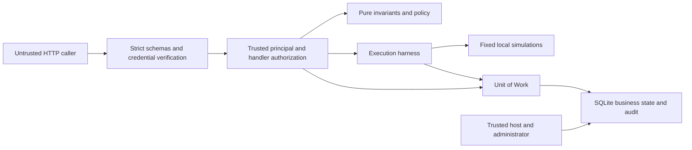

# Threat model

This model describes implemented controls for a local educational simulation.
It is not a comprehensive security certification or production-readiness claim.
There is no real money, payment integration, external LLM/MCP or arbitrary tool
execution. Evidence is in [scenario traceability](requirements_traceability.md).

## Assets, actors and trust boundaries

Assets include bearer credentials, trusted identities/allowlists, immutable
requests/fingerprints, approval bindings/deadlines, integer-cent balances,
durable results/idempotency records, ordered audit and repository integrity.

Actors are an untrusted client/agent, a separate approver credential holder,
contributors/CI and a trusted local operator/database administrator. Credentials
prove possession, not human presence or independence of operators. Stolen
credentials carry their holder's permissions. The host, clock, Python environment
and database administrator are trusted.

HTTP-to-core is a validation/identity boundary; core-to-storage is a transaction
and mapping boundary. Harness-to-tool is fixed dispatch, not a remote sandbox.
The filesystem/environment remain outside application access control. Dependency
installation can use the network; runtime has no outbound integration and tests
block outbound socket connections/subprocesses.

## Threats and controls

| Threat | Existing mitigation | Residual risk |
| --- | --- | --- |
| Spoofing agent/approver identity | Distinct validated environment tokens; constant-time comparison; server-derived roles/allowlists; rejected body overrides; direct-handler authorization | Bearer theft grants that role; no OAuth, MFA, human-presence proof or rotation service |
| Tampering with amount/tool/approved arguments | Closed strict schemas and independent domain validation; immutable request/fingerprint; approval bound to operation, owner, request and policy; execute accepts no body | Host can rewrite code/data; fingerprint checks are not administrator-resistant signatures |
| Privilege escalation or bypass dispatch | Least-privilege tool/source sets; owner checks/concealed 404; separate approver; harness-only dispatch; architecture and handler tests | AST rules are not a sandbox for hostile Python; dynamic plugins are unsupported |
| Approval replay or transplant | One conditional decision; inclusive 300-second expiry after creation, including grants; exact binding; current policy/permissions/funds revalidation; atomic consumption and success | Trusted wall clock; no automatic expiry worker; an old backup restores old authorization history |
| Duplicate execution, races or lost response | Principal/key/fingerprint uniqueness; serialized writes; durable terminal replay; balances/result/consumption/success audit share a transaction; uncertain-commit reconciliation | Single preserved database only; deleted/restored history or remote side effects invalidate this boundary; no distributed exactly-once promise |
| Partial effect / overspending | Integer cents; Account invariants and DB constraints; fresh facts under write lock; debit/credit/audit rollback together | Financial simulation only; no real settlement or production-grade distributed transactions |
| Credential leakage / exception disclosure | Token-hidden settings repr; no tokens in domain/storage; sanitized HTTP/unexpected-exception handling; audit field allowlist; sentinel tests across failure paths | No application-owned structured logging pipeline yet; host/proxy/debugger/environment/operator dumps may expose secrets |
| Audit injection, SQL-like input or prompt override | Known enums/IDs; no free-form prompt/note/executable field; parameterized SQL; no rejected raw input in audit; newline/secret sentinel tests | Administrator can edit/remove records; no signed or externally witnessed append-only log |
| Repudiation / missing evidence | Correlated IDs, trusted UTC timestamps, principal/approver, policy/reason and attempt records; no audit mutation route | Storage failure can prevent evidence; host clock and backups are not authenticated; fail-closed is not guaranteed audit availability |
| Exhaustion / contention | Streamed 16 KiB body bound; bounded IDs/keys and audit pages; cooperative two-second budget, two attempts, one <=50 ms delay; SQLite wait/progress limits | No rate limiting, retention/quota, hard real-time, production throughput or multi-host availability guarantee |
| Dependency/repository tampering | Locked Python dependencies; pinned CI actions/CLI; read-only CI permissions; test/lint/type/spec/architecture gates | Gates are neither formal verification nor certification; acquisition and host/CI administrators remain trusted |

## Trusted host and local SQLite limitations

Bind Uvicorn to `127.0.0.1`. There is no TLS termination or remote identity
perimeter. Loopback does not protect against other local processes. Restrict
access to credentials, source, SQLite files/sidecars and backups. Application
encryption at rest and a secret vault are not implemented. The README disables
access logging; external logging configuration must not expose untrusted paths
or credential headers. Sentinel tests cover captured application paths, not
every host/proxy/operator logging configuration.

Startup validates known schemas and mapping validates domain shapes; neither
detects every malicious administrative rewrite. Audit is not tamper-proof.
Follow [consistent backup/recovery](persistence.md) with a matching application
revision. Restoring an old backup loses newer results, approvals and audit;
replay protection is bounded by preserved history. Do not execute operations
as a restore check.

Deadlines cooperatively stop eligible uncommitted work; an entered commit/fsync
can finish after the budget. No worker can later commit a rolled-back transfer.
Arbitrary blocking or remote tools are unsupported. Future integrations require
reviewed cancellation/idempotency/reconciliation and a new threat assessment.
